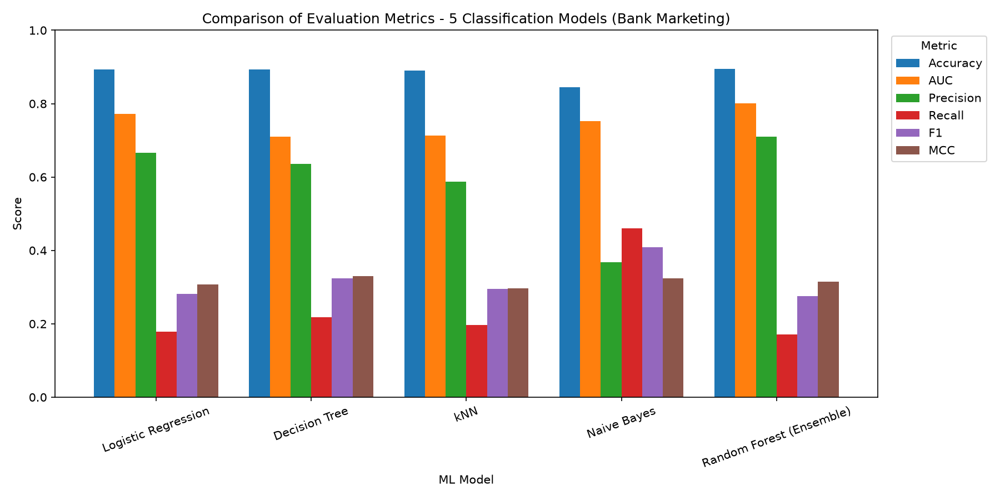

# Machine Learning Assignment 2 – Classification Models Comparison

**Course:** Machine Learning (AMLCCZG565) – BITS Pilani WILP, M.Tech (AIML)

**Prepared by:** Sathiskumar N

**BITS ID:** 2026CT05169

---

## a. Problem Statement
A Portuguese bank ran phone-call marketing campaigns to sell term deposits.
The goal of this project is to **predict whether a customer will subscribe to a term
deposit (yes / no)** using the customer's personal details and campaign information,
and to **compare the performance of 5 classification models** on the same dataset.

---

## b. Dataset Description
| Item | Details |
|---|---|
| **Source** | UCI Machine Learning Repository – [Bank Marketing Dataset](https://archive.ics.uci.edu/dataset/222/bank+marketing) |
| **File used** | `bank-full.csv` (semicolon-separated) |
| **Instances** | 45,211 |
| **Features** | 16 input features + 1 target (15 features used – see preprocessing) |
| **Target variable** | `y` – did the customer subscribe to a term deposit? (yes / no) |
| **Problem type** | Binary classification |

**Why this dataset?** It is a real banking/BFSI dataset with more than 12 features and
1,000 instances, it contains missing values (recorded as `"unknown"`), and it has a
strong class imbalance – so it meets all the assignment requirements and reflects a
realistic business problem.

**Feature types**
- **Numeric (7):** age, balance, day, duration, campaign, pdays, previous
- **Categorical (9):** job, marital, education, default, housing, loan, contact, month, poutcome

**Missing values ("unknown")**
| Column | "unknown" count | Handling |
|---|---|---|
| job | 288 | Treated as missing → filled with most frequent value (learned from training data) |
| education | 1,857 | Treated as missing → filled with most frequent value (learned from training data) |
| contact | 13,020 | Kept as its own category (too many rows to fill reliably) |
| poutcome | 36,959 | Kept as its own category (means "customer was not contacted in a previous campaign") |

**Class distribution (class imbalance)**
| Class | Count | Percentage |
|---|---|---|
| no (0) | 39,922 | 88.3% |
| yes (1) | 5,289 | 11.7% |

The dataset is **highly imbalanced** – a model that always predicts "no" would already
get about 88% accuracy. Therefore AUC, F1 and MCC are more meaningful than accuracy here.

---

## c. GitHub Repository Link
**https://github.com/sathiskumar-n/ml-classification-assignment**

**Repository structure**

- `model/bank_marketing_classification.ipynb` – complete notebook (preprocessing + all 5 models + metrics + graph)
- `model/data_preprocessing.py` – shared data loading, preprocessing and evaluation functions
- `model/logistic_regression.py` – Model 1: Logistic Regression
- `model/decision_tree.py` – Model 2: Decision Tree
- `model/knn.py` – Model 3: kNN
- `model/naive_bayes.py` – Model 4: Naive Bayes
- `model/random_forest.py` – Model 5: Random Forest (Ensemble)
- `model/about.md` – description of the model folder
- `README.md` – this file
- `requirements.txt` – required Python libraries
- `test_data.csv` – the 20% test split used for evaluation
- `metrics_comparison.png` – metrics comparison graph

**Execution instructions**

*Option 1 – Jupyter Notebook (all models together)*
1. Open `model/bank_marketing_classification.ipynb` in Jupyter Notebook (tested on BITS Virtual Lab).
2. Click **Run → Run All Cells**.
   - Step 0 installs the required libraries (`requirements.txt`).
   - Step 1 downloads the dataset directly from the UCI repository.
   - The remaining steps run preprocessing, train all 5 models and print the results table and graph.

*Option 2 – Run each model separately (Python files)*
1. Install the libraries: `pip install -r requirements.txt`
2. Go to the model folder: `cd model`
3. Run any model file, for example: `python logistic_regression.py`
   (also `decision_tree.py`, `knn.py`, `naive_bayes.py`, `random_forest.py`)
   - Each file uses `data_preprocessing.py`, downloads the dataset automatically and prints the 6 evaluation metrics.
   - The results are identical to the notebook (same preprocessing, settings and random seed).

---

## Data Preprocessing
1. **Missing values:** `"unknown"` in `job` and `education` converted to missing (NaN) and imputed with the most frequent value; `"unknown"` kept as a category for `contact` and `poutcome`.
2. **Duplicates:** checked – 0 duplicate rows found.
3. **Feature removed:** `duration` (call length) was dropped because it is only known **after** the call ends, so using it would cause data leakage (as advised in the UCI dataset notes).
4. **Encoding:** One-Hot Encoding for the 9 categorical features.
5. **Scaling:** StandardScaler for the 6 numeric features.
6. **Train-test split:** 80:20 (36,168 train / 9,043 test), **stratified** on the target to maintain the 88/12 class distribution, with a fixed random seed (`random_state=42`).
7. **No data leakage:** all preprocessing (imputer, encoder, scaler) is fitted **only on the training data** using a scikit-learn `ColumnTransformer` + `Pipeline`, and then applied to the test data.

After preprocessing: **48 features** (6 scaled numeric + 42 one-hot columns).

---

## d. Models Used

**Model configurations**

| Model | Configuration |
|---|---|
| Logistic Regression | `max_iter=1000`, `random_state=42` |
| Decision Tree | `max_depth=8`, `random_state=42` |
| kNN | `n_neighbors=7` |
| Naive Bayes | Gaussian Naive Bayes (default) |
| Random Forest (Ensemble) | `n_estimators=200`, `max_depth=12`, `random_state=42` |

### Comparison Table (evaluated on the 20% test set)

| ML Model Name | Accuracy | AUC | Precision | Recall | F1 | MCC |
|---|---|---|---|---|---|---|
| Logistic Regression | 0.8934 | 0.7718 | 0.6655 | 0.1786 | 0.2817 | 0.3073 |
| Decision Tree | 0.8938 | 0.7100 | 0.6354 | 0.2174 | 0.3239 | **0.3293** |
| kNN | 0.8899 | 0.7125 | 0.5871 | 0.1975 | 0.2956 | 0.2961 |
| Naive Bayes | 0.8444 | 0.7517 | 0.3681 | **0.4603** | **0.4091** | 0.3234 |
| Random Forest (Ensemble) | **0.8948** | **0.8012** | **0.7098** | 0.1711 | 0.2757 | 0.3142 |

### Metrics Visualization

### Observations

| ML Model Name | Observation about model performance |
|---|---|
| Logistic Regression | Good baseline with the 2nd-best AUC (0.77) and good precision (0.67), but very low recall (0.18). Being a linear model, it mostly predicts the majority class "no" and misses most real subscribers. |
| Decision Tree | Highest MCC (0.33) and slightly better recall (0.22) than Logistic Regression. However it has the lowest AUC (0.71), because a single tree gives coarse probability values, so it ranks customers poorly. Depth was limited to 8 to avoid overfitting. |
| kNN | Weakest overall – lowest MCC (0.30) and low AUC (0.71). Distance-based similarity works less well with 48 mostly one-hot (0/1) features, and prediction is slow on large data. |
| Naive Bayes | Behaves very differently from the others: lowest accuracy (0.84) but the **highest recall (0.46) and F1 (0.41)**. It predicts "yes" more often, so it finds many more real subscribers, but with many false alarms (precision 0.37). Useful if finding subscribers matters more than avoiding extra calls. |
| Random Forest (Ensemble) | **Best AUC (0.80), accuracy (0.89) and precision (0.71).** Combining 200 trees reduces variance and gives the best ranking of customers by probability of subscribing. Its recall is low (0.17) at the default 0.5 threshold, which could be improved by lowering the threshold or using class weights. |
| **Overall Winner for your dataset?** | **Random Forest (Ensemble)** – it has the highest AUC, which measures ranking ability independent of the threshold and is reliable on imbalanced data, along with the best accuracy and precision. If the business goal is to catch as many subscribers as possible, Naive Bayes (highest recall/F1) is the better choice. |

**Key learning:** All models reach about 89% accuracy, which is almost the same as always predicting "no" (88.3%). This shows that **accuracy alone is misleading on imbalanced data**, and metrics like AUC, F1 and MCC give a truer picture of model quality.
